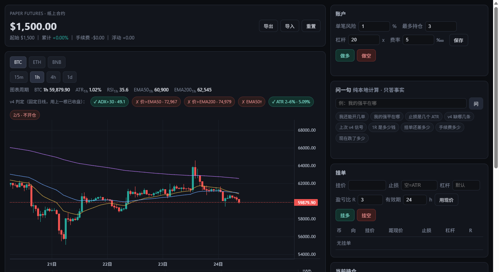
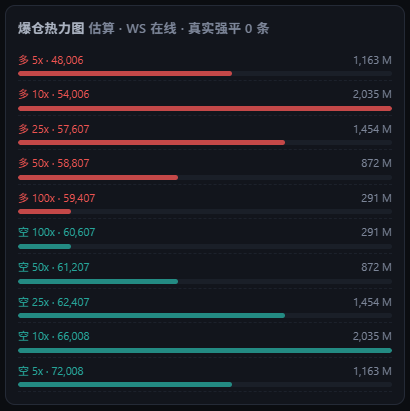
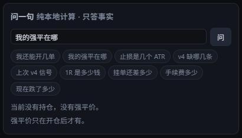

# Paper Futures · 纸上合约

**打开就能用的加密货币合约模拟盘。** 不用注册、不用 API Key、不碰真钱。

> 行情直连币安公开接口，账户和持仓存在你自己的浏览器里，不上传任何数据。

**第一次来？看 [安装与使用教程](INSTALL.md)** —— 三种用法、常见问题、能做什么不能做什么。

## 直接打开

**https://awds050204.github.io/paper-futures/**

第一次打开你会看到一个 **$1,500 的纸面账户**，空持仓。可以立刻开始下单。

> 有些人浏览器打不开 GitHub Pages，那就下载这个仓库的 `index.html`，
> 和 `lightweight-charts.js` 放同一个文件夹，双击 `index.html` 也能用（已实测）。

---

## 长什么样

[](https://awds050204.github.io/paper-futures/)

<details>
<summary>爆仓热力图 / 问一句</summary>

| 爆仓热力图 | 问一句 |
|---|---|
|  |  |

热力图按「未平仓量 × 常见杠杆档位」估算强平价位，**是估算不是真实分布**。
「问一句」是纯本地关键词匹配，只复述当前数字，**不做方向判断**。

</details>

---

## 第一次用，从这里开始

**1. 看行情** —— 左上角选币种（BTC / ETH / BNB）和周期（15m / 1h / 4h / 1d）

**2. 看 v4 判定** —— 状态下那五盏灯：

```
✓ ADX>30        趋势够不够强
✗ 价>EMA50      价格在不在均线上方
✗ 价>EMA200     是不是长期多头结构
✗ EMA50↑        均线在不在上行
✓ ATR 2–6%      波动率在不在合适区间
              ─────────
              2/5 · 不开仓
```

**五条全绿才算是「可开仓」**，但这只是提示，不是命令。

**3. 下单** —— 右上「做多 / 做空」

系统会按 **1% 的风险** 自动算数量，止损放在 **1.5×ATR**，止盈放在 **3 倍风险处**。
如果杠杆让爆仓比止损更早，它会自动把杠杆降下来并告诉你。

**4. 挂单** —— 填一个不到现价的买单（或高于现价的卖单），到价自动成交。

**5. 平仓** —— 持仓表最右边那个「平」字。

---

## 「问一句」是什么

面板中间那个输入框，**不是 AI**。

它是纯本地的关键词匹配：从你当前的账户状态里算出一段事实，不联网、不花钱、不会编。

**能问这些**（也有快捷按钮）：

| 问 | 答什么 |
|---|---|
| 我的强平在哪 | 每个持仓的强平价、距现价多少 % |
| 止损是几个 ATR | 止损距离 ÷ 日线 ATR |
| v4 缺哪几条 | 五条件逐条对错 |
| 上次 v4 信号 | 上一次五条全满足是哪天 |
| 我还能开几单 | 上限 − 当前持仓数 |
| 1R 是多少钱 | 账户 × 风险% |
| 挂单还差多少 | 每张挂单距触发还差几个百分点 |
| 手续费多少 | 费率与一笔交易的成本 |
| 现在跌了多少 | 距近 400 天高点 |
| 账户盈亏 | 已实现 + 浮动 |

**它拒绝回答的：**

> 该不该买？会不会涨？做多还是做空？

这类问题它会直接回「这个问题我不回答」。**它报事实，不做判断。**

**它答不上的**：凡是上面表里没有的说法，它都会回一句「我只会算，不会猜」并列出能问什么。
换句话说——**换了措辞就可能问不出来**，这是关键词匹配的硬伤。

---

## 数据在哪

存在**你自己浏览器的 localStorage**（键名 `paper.static.v1`）。

```
清浏览器缓存   →  账本没了
换设备         →  数据不跟过去
换浏览器       →  又是一份新的 $1,500
```

**所以定期用右上角「导出」存一份 JSON。** 换设备时「导入」回来。

---

## 不做什么

- ❌ 不接真实交易所，不能下真单
- ❌ 不构成投资建议
- ❌ 不收集任何用户数据（没有埋点、没有统计、没有第三方脚本）
- ❌ 没有新闻（RSS 不支持跨域，纯前端拿不到）

## 已知限制

- **爆仓热力图是估算**：用未平仓量 × 常见杠杆档位摊平，不是真实强平分布
- **手画不好**：用 SDXL 那类模型跑出来的图，手指会糊
- **v4 判定按「上一根已收盘的日线」**，所以盘中不会来回翻
- **只有 BTC / ETH / BNB**

---

## 自己部署

纯静态站点，两个文件：

```
index.html
lightweight-charts.js
```

放到 GitHub Pages / Cloudflare Pages / Vercel 都行，**不需要 Node、不需要后端、不需要数据库**。

**发给朋友**：把这两个文件压成 zip 发过去，解压后双击 `index.html`。
（`file://` 协议下浏览器能正常取币安行情，已实测。）

前提只有一个：**网络能访问 `fapi.binance.com`**。国内部分网络需要代理。

## 技术

原生 HTML + CSS + JavaScript，无框架、无构建步骤。
图表用 [lightweight-charts](https://github.com/tradingview/lightweight-charts)（Apache-2.0）。

## 许可

MIT
